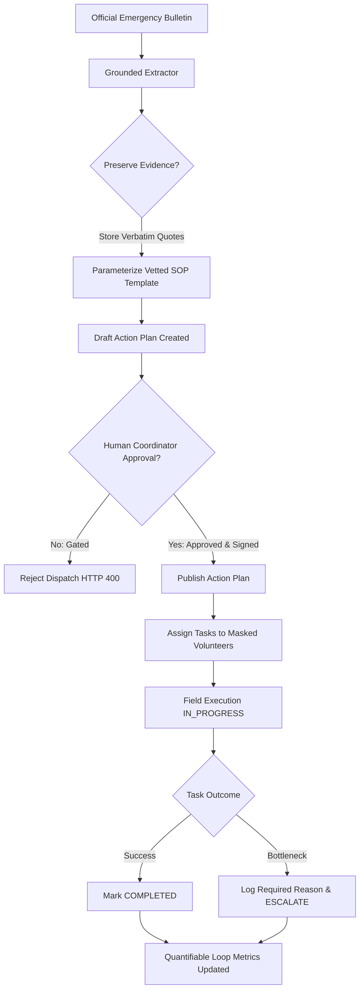
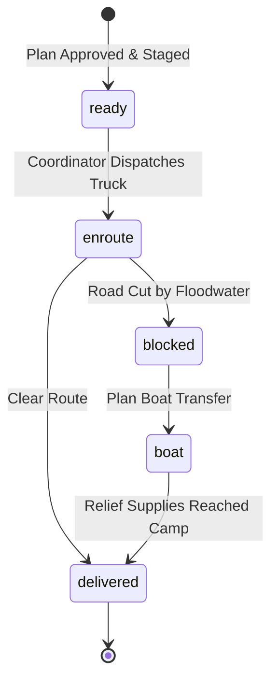

# Raabta (رابطہ) · Community Emergency Action Network

> **Open-Source Civic Resilience Platform**  
> Bridging the critical "last mile" between official disaster alerts and verifiable, evidence-grounded community action.

[](LICENSE)
[](https://fastapi.tiangolo.com/)
[](https://vitejs.dev/)
[](https://leafletjs.com/)
[](backend/tests/)
[](#7-offline-resilience--field-continuity)
[](#5-quickstart--installation)

---

## Table of Contents
1. [The Problem & The Raabta Solution](#1-the-problem--the-raabta-solution)
2. [Core Architecture & Operational Views](#2-core-architecture--operational-views)
   - [View 1: Relief Map & Supply Run Logistics](#view-1-relief-map--supply-run-logistics)
   - [View 2: Action Plan, Task Board & Community Incident Feed](#view-2-action-plan-task-board--community-incident-feed)
3. [Safety Guardrails & Governance Boundaries](#3-safety-guardrails--governance-boundaries)
4. [End-to-End System Workflows](#4-end-to-end-system-workflows)
5. [Quickstart & Installation](#5-quickstart--installation)
6. [Satellite Data Pipeline & Map Layer Generation](#6-satellite-data-pipeline--map-layer-generation)
7. [Offline Resilience & Field Continuity](#7-offline-resilience--field-continuity)
8. [Comprehensive REST API Reference](#8-comprehensive-rest-api-reference)
9. [2-Minute Step-by-Step Walkthrough Guide](#9-2-minute-step-by-step-walkthrough-guide)
10. [Automated Verification & Test Suite](#10-automated-verification--test-suite)
11. [Project Structure](#11-project-structure)
12. [Governance, Contributing & License](#12-governance-contributing--license)

---

## 1. The Problem & The Raabta Solution

### The "Last Mile" Failure in Disaster Response
During severe meteorological events—such as the monsoon riverine floods across Punjab and Sindh—national and international agencies (NDMA, PDMA, GDACS) broadcast high-level warnings. However, disaster response repeatedly breaks down at the community perimeter:

* **Passive Broadcasts vs. Actionable Execution**: Bulletins contain prose advisories (e.g., *"Indus discharge expected to exceed 600,000 cusecs"*), but local volunteer committees lack parameterized checklists detailing *who* must do *what*, *where*, and *by when*.
* **Hallucination & Misinformation Risks**: Ad-hoc generative AI chatbots often fabricate non-standard emergency advice, recommend flooded transit routes, or falsely declare unverified shelters "safe".
* **Disconnected Logistics**: Field coordinators cannot easily determine which supply roads are cut off by floodwaters, leading to relief convoys being stranded midway.
* **Communications Blackouts**: High-water events frequently knock out cellular towers and local power grids, rendering cloud-dependent applications unusable.

### The Raabta Approach
**Raabta (رابطہ - "Connection" / "Coordination")** transforms passive warnings into a closed-loop **Community Action Completion Engine**:

$$\text{Official Warning} \xrightarrow{\text{Grounded Extraction}} \text{Evidence-Linked Draft Plan} \xrightarrow{\text{Human Gate}} \text{Volunteer Dispatch} \xrightarrow{\text{State Machine}} \text{Escalation / Verification}$$

* **100% Grounded in Official Bulletins**: All extracted parameters (hazard type, severity, affected zones, onset timeframe) link directly to source quotations (`EvidenceAnchor`).
* **Vetted Standard Operating Procedures**: Emergency tasks are generated strictly from approved templates (`backend/app/templates.py`), preventing invented instructions.
* **Human Approval Gate**: Action plans remain locked in `DRAFT_PENDING_APPROVAL` status until a human coordinator verifies and signs off.
* **Spatial Road-Flood Intersection**: Real satellite flood rasters are cross-referenced against road networks to flag submerged transit segments before convoys depart.
* **Zero-API-Key Offline Resilience**: Full client-side caching (`localStorage`), pre-bundled vector/raster GIS layers, exportable JSON packs, and printable physical action cards.

---

## 2. Core Architecture & Operational Views

Raabta features a dual-view interface designed for both field logistics coordinators and volunteer team leaders.

```
+-----------------------------------------------------------------------------------+
|                           RAABTA CORE ARCHITECTURE                                |
+-----------------------------------------------------------------------------------+
|                                                                                   |
|   +-----------------------+     +------------------------+                        |
|   |   Official Bulletins  |     |   UNOSAT / VIIRS / COD |                        |
|   |   (NDMA, PDMA, GDACS) |     |   (Satellite & Layers) |                        |
|   +-----------+-----------+     +------------+-----------+                        |
|               |                              |                                    |
|               v                              v                                    |
|     [ Grounded Extractor ]          [ Map Layer Builder ]                         |
|     (Quoted Evidence Anchors)       (scripts/build_map_layers.py)                 |
|               |                              |                                    |
|               v                              v                                    |
|     [ Approved SOP Templates ]      [ Pre-Bundled GeoJSON / PNG ]                 |
|     (templates.py - No AI drift)    (public/data: water + districts + routes)     |
|               |                              |                                    |
|               +--------------+---------------+                                    |
|                              |                                                    |
|                              v                                                    |
|                     +------------------+                                          |
|                     |   FastAPI Core   |                                          |
|                     |   SQLite Store   |                                          |
|                     +--------+---------+                                          |
|                              |                                                    |
|                 +------------+------------+                                       |
|                 |                         |                                       |
|                 v                         v                                       |
|         [ VIEW 1: RELIEF MAP ]    [ VIEW 2: ACTION PLAN ]                         |
|         - District flood km²      - Human Approval Gate                           |
|         - Submerged road segments - Task State Machine                            |
|         - Supply runs (boat/truck)- Masked Volunteers                             |
|         - Food pack delivery rate - Unmet Needs Feed                              |
|                 |                         |                                       |
|                 +------------+------------+                                       |
|                              |                                                    |
|                              v                                                    |
|         [ RESILIENCE: Offline Cache + Printable Action Cards ]                    |
|                                                                                   |
+-----------------------------------------------------------------------------------+
```

---

### View 1: Relief Map & Supply Run Logistics
Accessible via the **"Relief map"** tab in the top navigation bar:

* **Satellite Flood Observations**: Displays real UNOSAT VIIRS multi-temporal satellite flood water detected over Pakistan (26 Aug to 7 Sep 2025).
* **District Vulnerability Triage**: Choropleth visualization and ranking of districts by submerged surface area ($\text{km}^2$), allowing instant focus zooming on hard-hit regions (e.g., Jalalpur Pirwala, Muzaffargarh, Shujabad).
* **Automated Road-Water Intersection**: Supply routes generated via OpenStreetMap / OSRM show real-time warnings when stretches are inundated (e.g., *"14.2 km of the road is under water"*).
* **Supply Run State Machine**: Tracks logistical runs from staging depots to displaced person camps:
  $$\text{Ready to send} \longrightarrow \text{On the way} \longrightarrow \text{Blocked by water} \longrightarrow \text{Boat transfer planned} \longrightarrow \text{Delivered}$$
* **Camp Provision Progress**: Real-time progress bars calculating verified delivered food packs and rations against camp needs.

---

### View 2: Action Plan, Task Board & Community Incident Feed
Accessible via the **"Action plan and tasks"** tab in the top navigation bar:

* **Evidence-Grounded Alert Panel**:
  * Displays source agency, publication URL, hazard classification, and timestamp.
  * Interactive **"View Source Citations"** drawer showing verbatim quotes extracted from the official text.
* **Human Approval Gate**:
  * Action plans remain in `DRAFT_PENDING_APPROVAL` status upon ingestion.
  * Prevents volunteer dispatch until a qualified coordinator reviews, logs remarks, and authorizes publication.
* **Operational Task Lifecycle Board**:
  * Categorizes tasks derived from vetted standard operating procedures (`templates.py`).
  * Enforces state machine transitions: `PENDING` $\to$ `ASSIGNED` $\to$ `IN_PROGRESS` $\to$ `COMPLETED` / `ESCALATED`.
  * **Mandatory Escalation Reason**: Volunteers cannot mark a task `ESCALATED` without logging specific field bottlenecks (e.g., structural debris, missing pump equipment).
* **Community Unmet Needs Feed**:
  * Intake for community-submitted road blockages, missing resources, and waterlogging alerts.
  * Every report begins as strictly `UNVERIFIED` until physically corroborated by coordinators.
* **Printable Physical Emergency Cards**:
  * Formatted via `@media print` (`Ctrl+P` or **"Print cards"** button) for immediate distribution to field teams operating in radio/cellular blackout zones.

---

## 3. Safety Guardrails & Governance Boundaries

To ensure safe deployment in high-stakes emergency situations, Raabta enforces six strict rules across its backend models, database constraints, and user interface:

| # | Safety Guardrail | Implementation & Enforcement Mechanism |
|---|---|---|
| **1** | **No AI-Invented Instructions** | Tasks are generated exclusively from pre-authorized operational templates (`backend/app/templates.py`). Dynamic alert parsing only populates parameters (`affected_zones`, `onset_time`, `primary_assembly_point`). LLMs are never permitted to generate unreviewed safety advice. |
| **2** | **Evidence Anchoring** | Every extracted parameter must retain an `EvidenceAnchor` containing the verbatim substring from the official bulletin. Displayed transparently in the UI citation drawer. |
| **3** | **Human Approval Gate** | The backend rejects any attempt to assign, start, or dispatch tasks while `ActionPlan.status == "DRAFT_PENDING_APPROVAL"` with HTTP 400 Bad Request. Requires an explicit signature via `POST /api/action-plans/{id}/approve`. |
| **4** | **No False Safety Labels** | Map locations and assembly points cannot be labeled "safe". All shelters default to `"designated assembly point — verification required"` until official ground clearance is authenticated. |
| **5** | **Privacy by Design** | Volunteer phone numbers are masked in public endpoints (`+92-300-***-4521`). Private coordinates and medical details of vulnerable households are quarantined from public map layers. |
| **6** | **Zero-Cloud Field Continuity** | The application functions without external paid APIs, map tile keys, or external databases. If connection drops, operations continue from client-side `localStorage` cache. |

---

## 4. End-to-End System Workflows

### The Action Completion Loop



### The Supply Run State Machine



---

## 5. Quickstart & Installation

### Prerequisites
* **Python**: 3.11+
* **Node.js**: 18+ and `npm`
* **Operating System**: Windows, macOS, or Linux (Zero platform-specific C-extensions required)

---

### Backend Setup

```bash
# 1. Clone the repository
git clone https://github.com/M-Wajeeh/raabta.git
cd raabta

# 2. Install backend dependencies
python -m pip install -r backend/requirements.txt

# 3. Verify backend test suite (9 core tests)
python -m pytest backend/tests -v

# 4. Start the FastAPI server
python -m uvicorn backend.app.main:app --host 127.0.0.1 --port 8000 --reload
```

* Backend API runs at: `http://127.0.0.1:8000`
* Interactive Swagger Docs: `http://127.0.0.1:8000/docs`
* OpenAPI JSON Specification: `http://127.0.0.1:8000/openapi.json`

---

### Frontend Setup

In a separate terminal window:

```bash
# 1. Navigate to frontend directory and install dependencies
cd frontend
npm install

# 2. Start the Vite development server
npm run dev
```

* Frontend dashboard opens at: `http://localhost:5173`
* Vite automatically proxies all `/api/*` network requests to `http://127.0.0.1:8000`.

---

## 6. Satellite Data Pipeline & Map Layer Generation

Raabta comes pre-bundled with real satellite observations and GIS vectors located in `frontend/public/data/`. To understand or rebuild these layers:

```bash
# Optional: Rebuild satellite flood, district, and route layers
python scripts/build_map_layers.py
```

### What `scripts/build_map_layers.py` Does:
1. **Satellite Raster Ingestion (`flood-2025.png`)**:
   * Queries UNOSAT's VIIRS flood detection service (`VIIRS20250909PAK`) covering the Pakistan geographic bounding box (`[23.6, 60.8]` to `[37.1, 77.9]`).
   * Fetches the permanent water mask and computes a binary difference to isolate active standing floodwaters from normal river channels.
2. **Administrative Boundary Intersection (`districts.geojson`)**:
   * Pulls OCHA / WFP Common Operational Datasets (COD-AB) for administrative level 2 (Districts).
   * Calculates the exact submerged area in square kilometers ($\text{km}^2$) for each district by projecting polygon coordinates into Mercator space and evaluating pixel counts adjusted for latitude cosine shrinkage (`ROW_KM2`).
3. **Road Network Routing & Submerged Kilometer Calculation (`routes.geojson`)**:
   * Takes supply run origin and destination coordinates (e.g., Multan depot to Jalalpur Pirwala camp).
   * Snaps endpoints to the road network and queries the Open Source Routing Machine (OSRM).
   * Walks the road polyline against the satellite flood raster: if coordinates cross inundated pixels, that segment is tagged as `flooded` and the submerged distance is computed.

---

## 7. Offline Resilience & Field Continuity

In disaster scenarios where connectivity is sporadic or nonexistent:

1. **Client-Side Storage**: The frontend API wrapper (`frontend/src/api.js`) automatically mirrors active action plans, volunteer directories, assembly points, and incident reports to browser `localStorage`.
2. **Manual Offline Simulation Toggle**: Field operators can click the **"Live Operations"** / **"Offline"** button in the header bar to simulate a total network loss. The UI continues to allow task updates and report submissions, persisting changes locally.
3. **Bundled Static GIS**: Map layers (`flood-2025.png`, `districts.geojson`, `routes.geojson`) reside in `frontend/public/data/` and do not require tile server connections to render basic district and route data.
4. **Offline Pack Export**: Click **"Offline pack"** to download a unified `raabta_offline_pack_YYYY-MM-DD.json` containing the entire active scenario, volunteer contact rosters, assembly coordinates, and standard safety protocols.
5. **Physical Emergency Action Cards**: Field volunteers without smartphones receive paper task cards generated via the **"Print cards"** button or standard browser print (`Ctrl+P`).

---

## 8. Comprehensive REST API Reference

All requests and responses use JSON. Timestamps follow ISO-8601 UTC format.

### Health & System
| Method | Endpoint | Description |
|---|---|---|
| `GET` | `/api/health` | Service uptime and timestamp |

---

### Alert Ingestion & Action Plans
| Method | Endpoint | Description |
|---|---|---|
| `POST` | `/api/alerts/parse` | Ingests raw text bulletin, extracts grounded parameters, anchors evidence, and creates a `DRAFT_PENDING_APPROVAL` action plan. |
| `POST` | `/api/action-plans/{plan_id}/approve` | **Human Approval Gate**: Authorizes a draft plan for volunteer dispatch. |
| `GET` | `/api/action-plans/current` | Retrieves the active approved action plan (or latest draft). |
| `GET` | `/api/action-plans/{plan_id}` | Retrieves a specific action plan by ID. |

#### Sample Request: `POST /api/alerts/parse`
```json
{
  "raw_text": "URGENT FLASH FLOOD BULLETIN: River Chenab water levels rising rapidly near Shujabad and Jalalpur. Evacuation preparedness ordered within 4 hours by PDMA.",
  "source_agency": "Provincial Disaster Management Authority (PDMA)",
  "source_url": "https://pdma.punjab.gov.pk/bulletins/alert-2025-08"
}
```

#### Sample Response (Truncated)
```json
{
  "id": "plan-flood-2025-08",
  "alert_id": "alert-172500",
  "title": "Community Flash Flood Action Plan — Shujabad, Jalalpur",
  "hazard_type": "FLOOD",
  "status": "DRAFT_PENDING_APPROVAL",
  "source_agency": "Provincial Disaster Management Authority (PDMA)",
  "evidence_anchors": [
    {
      "field_name": "hazard_type",
      "extracted_value": "FLOOD",
      "source_quote": "FLASH FLOOD BULLETIN: River Chenab"
    },
    {
      "field_name": "onset_time",
      "extracted_value": "4 hours",
      "source_quote": "within 4 hours by PDMA"
    }
  ],
  "tasks": [
    {
      "id": "task-01",
      "task_code": "FLD-01",
      "title": "Verify Designated Assembly Point & Evacuation Route",
      "status": "PENDING",
      "location_status": "designated assembly point — verification required"
    }
  ]
}
```

---

### Task Lifecycle & State Transitions
| Method | Endpoint | Description |
|---|---|---|
| `PATCH` | `/api/tasks/{task_id}` | Transitions task state (`PENDING`, `ASSIGNED`, `IN_PROGRESS`, `COMPLETED`, `ESCALATED`). Requires volunteer info for assignment; requires `escalation_reason` for escalation. |

#### Sample Request: `PATCH /api/tasks/{task_id}`
```json
{
  "status": "ESCALATED",
  "escalation_reason": "Culvert blocked by fallen timber; tractor or excavator required to restore flow."
}
```

---

### Volunteers & Privacy
| Method | Endpoint | Description |
|---|---|---|
| `GET` | `/api/volunteers` | Lists available volunteers with privacy-masked telephone contacts. |

---

### Community Incident Reports
| Method | Endpoint | Description |
|---|---|---|
| `GET` | `/api/reports` | Lists all community-submitted hazard and unmet need reports. |
| `POST` | `/api/reports` | Submits a new report (strictly defaults to `UNVERIFIED`). |
| `PATCH` | `/api/reports/{report_id}/verify` | Coordinator action to mark report `VERIFIED` or `REJECTED`. |

---

### Assembly Points & Locations
| Method | Endpoint | Description |
|---|---|---|
| `GET` | `/api/locations` | Lists designated assembly points and coordinates. |
| `PATCH` | `/api/locations/{location_id}/status` | Updates verification status. Rejects misleading "safe" designations without verified confirmation. |

---

### Metrics & Scenario Controls
| Method | Endpoint | Description |
|---|---|---|
| `GET` | `/api/metrics` | Returns quantifiable loop statistics (% completed, in-progress, escalated, unverified reports). |
| `POST` | `/api/scenario/reset` | Resets SQLite database and demo state to initial Multan/Muzaffargarh scenario. |
| `GET` | `/api/scenario/export` | Returns complete offline bundle payload. |

---

## 9. 2-Minute Step-by-Step Walkthrough Guide

Follow these steps to experience the complete Raabta action completion loop:

1. **Launch the Demo**:
   * Open `http://localhost:5173`.
   * Notice the initial **"Relief map"** view displaying satellite floodwater across southern Punjab.
2. **Explore Flooded Districts & Logistics**:
   * In the right panel under **"Most flooded districts"**, click **Muzaffargarh** or **Jalalpur Pirwala**. Notice the map zooms dynamically to the flooded terrain.
   * Under **"Supply runs"**, locate the **Multan to Jalalpur Pirwala** run. Notice the badge: `Blocked by water` with an alert indicating that 14.2 km of the roadway is submerged.
   * Click **"Plan boat transfer"** to transition the convoy to waterborne logistics. Notice the status updates to `Boat transfer planned`.
3. **Review Grounded Evidence & Citations**:
   * Switch tabs to **"Action plan and tasks"**.
   * In the top alert panel, click **"View Source Citations"**. Inspect how the extracted hazard type, onset timeframe, and affected lowlands match exact quotations from the official disaster advisory.
4. **Advance the Volunteer State Machine**:
   * On the Task Board, locate pending task `[FLD-04]` (*"Establish Local Emergency Comms & Radio Check"*).
   * Click **"Assign Volunteer"** and select **Amina Khan**.
   * Click **"Start Execution"** $\to$ status moves to `In Progress`.
   * Click **"Mark Complete"** $\to$ notice the top completion percentage metric increments immediately.
5. **Inspect Escalation Guardrails**:
   * Examine task `[FLD-03]` marked with an amber `ESCALATED` border.
   * Review the logged reason: *"Depot stock depleted: 150 additional sandbags required at Sector 4 culvert immediately."*
   * Bottlenecks are surfaced explicitly to coordinators rather than obscured.
6. **Verify a Community Report**:
   * In the **Unmet Needs Feed**, find the unverified community report (*"Canal Underpass Waterlogging"*).
   * Click **"Verify"** to promote it from `UNVERIFIED` to `VERIFIED`.
7. **Simulate Comms Blackout**:
   * Click the **"Live Operations"** toggle in the header to switch to **"Offline"**.
   * Notice the amber banner. The UI remains responsive; tasks and reports continue to update within client storage.
8. **Inspect Printable Field Cards**:
   * Click **"Print cards"** (or press `Ctrl+P`) to preview the print-formatted cards ready for deployment.

---

## 10. Automated Verification & Test Suite

The test suite in `backend/tests/test_api.py` verifies all core governance boundaries and business logic. Run tests with:

```bash
python -m pytest backend/tests -v
```

### Verified Assertions:
* `test_health`: Verifies API uptime, service status, and UTC timestamp formatting.
* `test_alert_extraction_and_evidence_anchors`: Asserts that parameter extraction preserves source quotes and prevents fabricated values.
* `test_human_approval_gate_blocks_execution_until_approved`: Asserts that task assignment or progress is blocked with HTTP 400 while in `DRAFT_PENDING_APPROVAL` status.
* `test_task_state_machine_escalation_requires_reason`: Confirms that transitioning a task to `ESCALATED` without an explicit explanation fails schema validation (HTTP 422).
* `test_location_status_rule_prohibits_unverified_safe_label`: Prohibits setting location status to `"safe"` without authorized clearance.
* `test_community_incident_report_lifecycle`: Ensures newly submitted community incidents strictly default to `UNVERIFIED` until coordinator verification.
* `test_metrics_calculation`: Validates accurate percentage and tally calculations across completed, in-progress, and escalated tasks.
* `test_privacy_masking_in_volunteer_directory`: Asserts that volunteer phone numbers and identifying credentials are appropriately masked.
* `test_offline_export`: Validates the structure and completeness of the generated offline action pack.

---

## 11. Project Structure

```
hacktoberXnstp/
├── .agents/                    # Agentic engineering rules & governance context
│   ├── rules/                  # Specific policy boundaries (quality, approval, security)
│   └── AGENTS.md               # Project-specific guidelines
├── backend/
│   ├── app/
│   │   ├── __init__.py         # Package declaration
│   │   ├── main.py             # FastAPI application, routing, and lifecycle handlers
│   │   ├── models.py           # Pydantic schemas, enums, and request/response models
│   │   ├── database.py         # SQLite connection management and table initialization
│   │   ├── extractor.py        # Evidence-grounded alert parsing and anchor generation
│   │   ├── templates.py        # Vetted Standard Operating Procedure (SOP) templates
│   │   └── seed.py             # Seeded Multan / Muzaffargarh flood scenario
│   ├── tests/
│   │   └── test_api.py         # 9 automated boundary and workflow tests
│   └── requirements.txt        # Backend dependencies (FastAPI, Uvicorn, Pydantic, Pytest)
├── frontend/
│   ├── public/
│   │   └── data/               # Pre-bundled offline GIS data
│   │       ├── flood-2025.png  # UNOSAT VIIRS satellite flood raster
│   │       ├── districts.geojson# Administrative boundaries with calculated flood km²
│   │       └── routes.geojson  # OSRM road routes with flooded segment markers
│   ├── src/
│   │   ├── components/
│   │   │   ├── AlertExtractor.jsx  # Alert viewer, citations drawer, approval gate
│   │   │   ├── Header.jsx          # Top navigation bar and offline toggle
│   │   │   ├── IncidentFeed.jsx    # Community incident submission and verification
│   │   │   ├── MapView.jsx         # Secondary tactical leaflet map
│   │   │   ├── MetricsBar.jsx      # Quantifiable action loop completion metrics
│   │   │   ├── PrintableCards.jsx  # Printable physical emergency action cards
│   │   │   ├── ReliefMap.jsx       # Satellite flood map with route and district layers
│   │   │   ├── ReliefView.jsx      # Split container for map and supply run panel
│   │   │   ├── SupplyPanel.jsx     # Supply run state machine and district triage
│   │   │   └── TaskBoard.jsx       # Volunteer task assignment and lifecycle board
│   │   ├── api.js              # Client library with offline localStorage fallback
│   │   ├── App.jsx             # Root layout and view switcher
│   │   ├── index.css           # Core styling, responsive grid, print styles
│   │   ├── main.jsx            # Application bootstrap
│   │   ├── relief.css          # Dark-mode GIS and logistics styling
│   │   └── scenario.js         # Sample depot, camp, and supply run configuration
│   ├── package.json            # React, Vite, Leaflet, Lucide-React configuration
│   └── vite.config.js          # Vite configuration and backend API proxy
├── scripts/
│   └── build_map_layers.py     # Python GIS pipeline building bundled map assets
├── PROJECT_GOVERNANCE.md       # Operational rules, boundaries, and acceptance criteria
├── LICENSE                     # MIT Open Source License
└── README.md                   # This documentation
```

---

## 12. Governance, Contributing & License

### Governance Principles
Raabta is developed under strict civic-tech governance principles outlined in [PROJECT_GOVERNANCE.md](PROJECT_GOVERNANCE.md):
* **No Speculative Architecture**: No unnecessary microservices, external message queues, or costly cloud dependencies.
* **Deterministic Behavior Over Probabilistic Guessing**: In disaster response, a verifiable checklist from a known standard operating procedure is always preferable to dynamic AI generation.

### Contributing
Contributions are warmly welcomed! Areas where community contributors can help:
1. **Regional Standard Operating Procedures**: Adding localized emergency response templates (`backend/app/templates.py`) for earthquakes, heatwaves, or cyclones.
2. **Multilingual Localizations**: Translating the interface into Urdu (اردو), Sindhi (سنڌي), Pashto (پښتو), and Balochi (بلوچی).
3. **SMS / IVR Integration**: Light-weight adapter services to broadcast approved task cards to feature phones via open GSM gateways.

### License
This project is open-source software licensed under the [MIT License](LICENSE).
